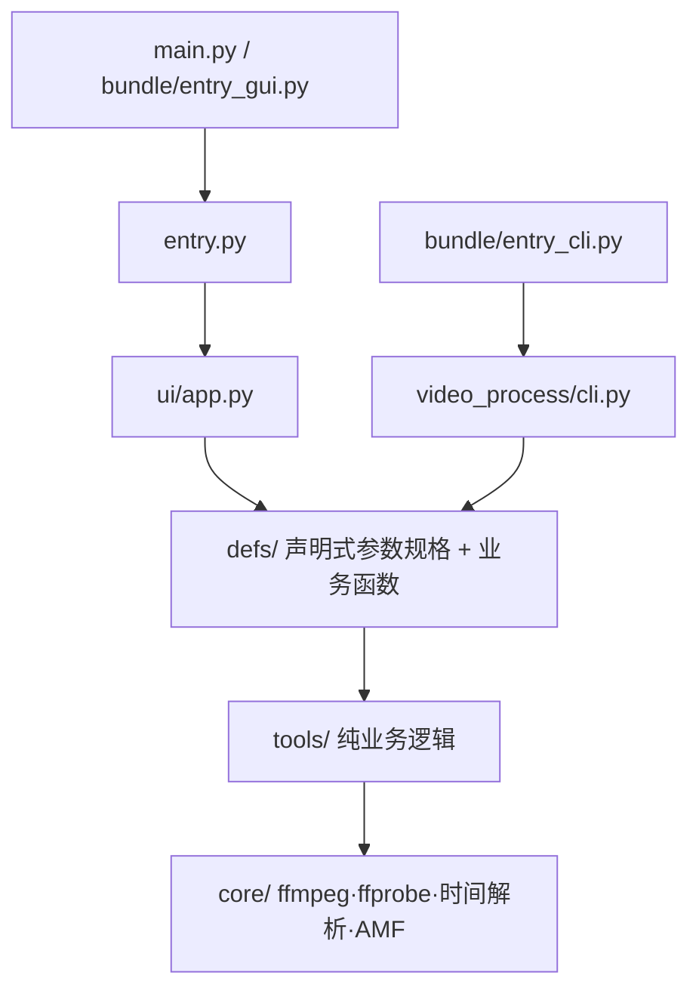

## 用户需求
为现有桌面版视频/字幕处理工具集补齐命令行版本，让每个功能都能在终端直接调用；把用法写进 README；生成一个可复用的项目技能包；并让 GitHub Actions 构建流程同时产出命令行版本的可执行产物。

## 产品概述
桌面图形界面保持原样，另外新增一个统一命令行入口：用户在终端一条命令即可完成合并、裁剪、去广告、片段提取、分割、压缩、转码、音轨提取、视频截图、字幕转换与导出、时间线重算、繁简转换等操作，也可被脚本或批处理循环调用。

## 核心功能
- 单一入口加子命令：`python -m video_process.cli 功能名 [选项]`；不带参数时列出全部功能，每个功能加 `--help` 显示参数含义、默认值与取值范围。
- 参数与图形界面完全对齐：同名字段、同默认值、同取值范围、同校验规则；未指定参数时自动采用全局配置中的默认值。
- 全局开关：静默模式（只显示告警与错误）、临时允许覆盖已存在输出（不改写配置文件）、查看版本。
- 输出约定：运行日志与结果摘要走错误流，产物路径或纯文本结果走标准输出，可直接管道重定向或重定向到文件；成功、失败、参数错误分别对应 0、1、2 三种退出码。
- 纯文本类功能（时间线重算、繁简转换）支持从标准输入读取，便于参与管道组合。
- 运行中按 Ctrl+C 可干净取消：终止后台转码进程，不留残余进程与半成品残留。
- 打包产物：图形界面版维持现状，新增控制台版可执行程序；两者都内置转码引擎，目标机无需安装 Python 或 ffmpeg。
- 构建流水线：一次构建同时产出图形界面版与控制台版，冒烟检查同时校验两个可执行文件，并分别输出可下载的构建产物与发布附件。
- 文档：README 新增命令行章节（入口写法、全部功能一览、全局选项、输出与退出码、时间格式、示例、打包用法），并同步打包章节的产物与文件清单。
- 技能包：项目级技能，说明何时使用以及完整的命令速查，供后续会话直接调用。


## 技术栈
- 语言/运行时：沿用现状 Python 3.9+，零新增第三方依赖
- 参数解析：标准库 `argparse`（含 `BooleanOptionalAction`）
- 业务复用：直接调用 `video_process/defs` 的 `ToolDefinition.resolve_runner()`，不复制任何 ffmpeg 逻辑
- 打包：沿用 PyInstaller 与现有 spec，新增控制台入口
- CI：沿用现有 `build.py` + `bundle/video_process.spec`，通过环境变量选择构建目标

## 实现方案
核心策略是「参数表不手写第二份」。`defs/` 已经是与界面无关的唯一事实来源（`ParamSpec` + 业务函数），图形界面与命令行只是它的两个消费者：

- 遍历 `defs.all_tools()`，为 `resolve_runner() is not None` 的定义生成子命令（跳过纯界面面板 `settings`），得到 16 个子命令：`merge`、`trim-edges`、`batch-trim`、`remove-segments`、`extract-segments`、`split`、`compress`、`convert`、`audio`、`frame`、`srt2ass`、`srt-remove`、`jianying-subtitle`、`bcut-subtitle`、`timeline`、`zh-convert`
- `ParamSpec.kind` 到 `argparse` 的映射：

| kind | 参数形式 |
|---|---|
| `int` / `float` | `--name 值`，`type=int` / `type=float` |
| `choice` | `--name 值`，`choices` 取 spec `choices` 的**实际值**；全部为 int 时 `type=int`（兼容 merge/convert 的 1/2/3） |
| `bool` | `--name` / `--no-name`（`BooleanOptionalAction`） |
| `text` / `path` / `dir` / `file` / `outdir` | `--name 值`，字符串 |

  参数名用 kebab（`--output-dir`），回填给业务函数的字典仍用 `spec.name`（snake_case），因此 `runner(ctx=ctx, **values)` 与 `ui/tasks.py:75-79` 完全一致。
- 默认值：复刻 `ui/panels/base.py:190-201` 的规则——`spec.setting` 有值且 `getattr(settings, setting)` 不为 None 时用设置值，否则用 `spec.default`（保证「留空=自动」语义不被顶掉）；settings 来自 `settings_store.load_settings()`。
- 必填：仅当 `spec.required and spec.default in (None, "")` 时设为 argparse 必填；`multiline` 参数一律不设必填，改用标准输入兜底。
- 校验：解析后只对 `spec.should_show(values)` 为真的参数执行 `validator`，失败走 `parser.error()`（退出码 2），与界面校验语义一致。
- 执行：`ToolContext(on_log=…, on_progress=…, is_cancelled=cancel_event.is_set, settings=settings)`，捕获 `CancelledError / ToolError / Exception` 并转为失败结果（与 `ui/tasks.py` 同构）。
- 取消：SIGINT 处理器只 `threading.Event.set()`，由 `FFmpegRunner.run()` 现有的 0.1s 轮询完成 `taskkill /F /T` 杀进程树，避免 `KeyboardInterrupt` 从业务层逃逸。
- 输出：`on_log` 写 stderr 并按级别过滤（`-q` 只留 WARNING/ERROR）；进度仅在 `stderr.isatty()` 时用 `\r` 刷新；`TaskResult.message` 与 `warnings` 写 stderr；`TaskResult.outputs` 逐行写 stdout（文本类工具得到纯文本，文件类工具得到产物路径列表，可 `> list.txt`）。
- 打包目标矩阵（spec 新增 `VP_TARGETS`）：

| VP_TARGETS | onedir | onefile |
|---|---|---|
| `both`（默认） | 两个 EXE 共用一个 `COLLECT`，binaries 取 GUI 分析的超集 | 两个独立 EXE，各带各的 binaries |
| `gui` | 现有行为 | 现有行为 |
| `cli` | 只做 CLI Analysis，`COLLECT(exe_cli, a_cli.binaries, …)`，不含 Qt | 只产控制台单文件 exe，不含 Qt，体积显著小于 GUI |

- CI 构建序列：`build.py --clean`（both，单目录）→ 冒烟两个 exe → 压缩目录为 `video-process-<ver>-win64.zip` → `build.py --onefile --targets cli` → 冒烟控制台单文件 → 压缩为 `video-process-cli-<ver>-win64.zip` → 一次 `upload-artifact`（`video-process-*.zip`）→ Release 附件同一 glob。

性能与代价：解析器构建 O(工具数)，每进程一次，可忽略；`both` 模式多一次依赖分析（构建时间约增加），但 onedir 复用 GUI 的 binaries，产物体积不会翻倍；CI 第二次构建（CLI 单文件）单独付出一次分析+打包时间，换来体积小、可直接分发的独立命令行产物。

## 实现要点与风险控制
- `video_process/cli.py` 绝不 import PyQt6：`defs`/`tools`/`core` 已与界面解耦，一旦间接引入 `ui`，单文件命令行产物会拖进整个 Qt
- 入口顺序不能反：先 `ensure_utf8_stdio()`（Windows 中文控制台 GBK 兜底），再 `prepare_ffmpeg_path()`（打包后转码引擎靠 PATH 注入）
- 全局选项与 spec 名冲突检查：现有 specs 无 `quiet` / `overwrite` / `version`，可安全挂在子命令上
- `--overwrite` 只改内存中的 `Settings`，不写回 `~/.video-process/config.json`，避免命令行副作用污染图形界面默认值
- 标准输入兜底：显式传 `-` 或 `multiline` 参数缺省且 `stdin` 非 tty 时才读取，tty 下缺参直接报错退出 2，避免命令行挂起等输入
- 标准输出只写结果、不写日志，保证 `> out.txt` 与管道干净可用
- 不改 `tools/`、`core/`、`ui/`、`defs/` 任何行为；只新增文件与打包/CI/文档改动，零回归面
- CI 中文文件名沿用现有 `test -f` 校验方式（不执行），避免 shell 编码坑；第二次构建不加 `--clean`，以免删掉刚压缩前的产物目录
- 命令行单文件内置转码引擎后体积较大（与「目标机零依赖」一致），构建日志与 README 中明确说明

## 架构设计
沿用现有四层单向依赖，命令行接在 `defs` 之上，与 `ui` 平级，互不依赖：



## 目录结构
```
video-process/
├── video_process/
│   └── cli.py                  # [NEW] 唯一 CLI 实现：初始化（UTF-8 控制台 + PATH 注入）；
│                               #   遍历 defs.all_tools() 生成 16 个子命令（跳过 runner 为 None 的 settings）；
│                               #   ParamSpec→argparse 映射、setting 默认值、should_show 校验、stdin 兜底；
│                               #   ToolContext（日志/进度/取消）、SIGINT→threading.Event；
│                               #   outputs→stdout、日志与摘要→stderr、退出码 0/1/2；
│                               #   main(argv=None)->int 供 -m 与 console script 共用；不 import PyQt6
├── bundle/
│   ├── entry_cli.py            # [NEW] 控制台入口薄封装：from video_process.cli import main
│   └── video_process.spec      # [MODIFY] 新增 VP_TARGETS（both/gui/cli）与 VP_CLI_NAME（默认
│                               #   「视频处理工具集-命令行」）；按目标创建 GUI/CLI 两套 Analysis；
│                               #   console=True 的第二个 EXE；onedir 时两个 EXE 共用一个 COLLECT
│                               #   （binaries 取 GUI 超集，cli-only 时取 a_cli.binaries）；
│                               #   onefile 时各 EXE 带各自 binaries
├── build.py                    # [MODIFY] 新增 --targets {both,gui,cli} 并透传 VP_TARGETS、
│                               #   透传 VP_CLI_NAME；clean() 按目标清理对应产物（含命令行 exe）；
│                               #   report() 按目标打印产物路径并给出一行 CLI 用法示例
├── pyproject.toml              # [MODIFY] [project.scripts] video-process-cli = "video_process.cli:main"
├── README.md                   # [MODIFY] 新增「命令行（CLI）」章节：三种入口写法、16 个子命令表
│                               #   （id/功能/必填参数）、全局选项、stdout/stderr 约定、退出码、
│                               #   时间格式与典型示例（含管道）、配置文件说明；
│                               #   同步「产物」表、「打包相关文件」清单与打包参数说明（--targets）
├── e2e_check.py                # [MODIFY] 追加 CLI 自检：遍历 defs 为每个子命令构建 parser 不报错、
│                               #   各子命令 --help 返回 0；timeline 纯文本用例（不依赖 ffmpeg）
├── .github/workflows/build.yml # [MODIFY] 打包后冒烟校验两个 exe；新增 --onefile --targets cli 步骤
│                               #   产出独立命令行 exe；压缩为 video-process-cli-<ver>-win64.zip；
│                               #   upload-artifact 与 Release 的 files 覆盖两类压缩包
└── .codebuddy/
    └── skills/
        └── video-process-cli/
            └── SKILL.md        # [NEW] YAML frontmatter（name: video-process-cli；description 用第三人称
                                #   说明触发场景：用命令行批量处理视频/字幕/时间线）；
                                #   正文：入口三种写法、16 子命令速查表（id/功能/必填参数）、
                                #   全局选项、时间格式、输出与退出码、典型组合示例（含管道）、
                                #   打包 exe 调用方式、配置文件路径；提示 --help 为权威说明
```

## 关键约定（接口契约）
- 子命令名即 `ToolDefinition.id`；`settings` 不提供子命令
- `main(argv: Optional[Sequence[str]] = None) -> int`，模块底部 `if __name__ == "__main__": raise SystemExit(main())`，`python -m video_process.cli`、安装后的 `video-process-cli`、打包后的控制台 exe 三者共用同一实现
- 无子命令时打印总帮助返回 0；未知子命令由 argparse 报错返回 2


## Agent Extensions
### Skill
- **skill-creator**
  - Purpose: 按 CodeBuddy 技能规范创建项目级技能骨架（`init_skill.py`）并校验 frontmatter、命名与目录结构，确保 `name` 与目录同名、`description` 明确触发场景
  - Expected outcome: `.codebuddy/skills/video-process-cli/SKILL.md` 结构合法、正文为完整的命令速查（16 个子命令、全局选项、示例、退出码、配置路径），示例 scripts/references/assets 已删除，可被后续会话直接加载使用
